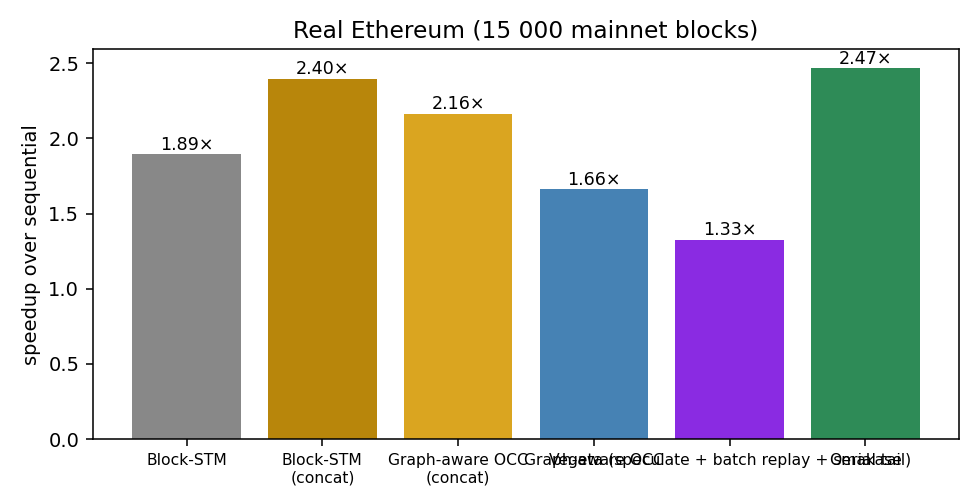
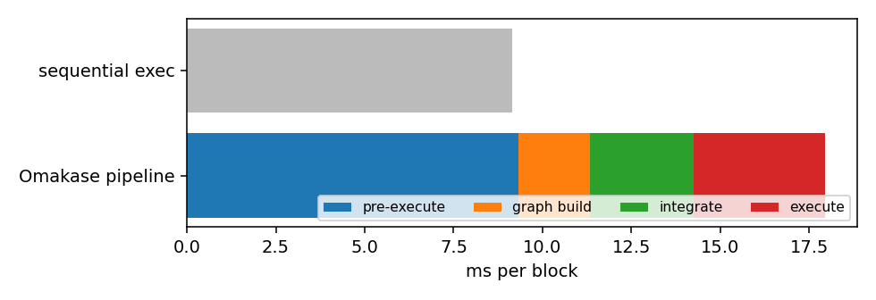
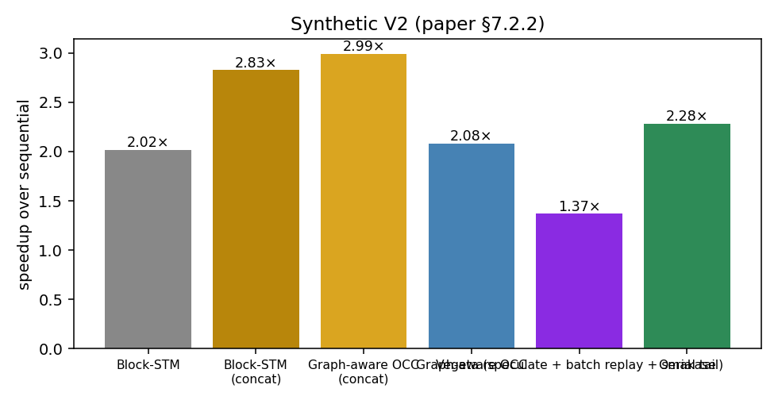
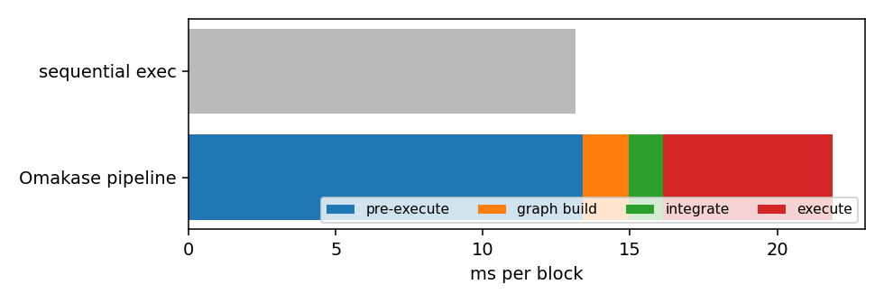
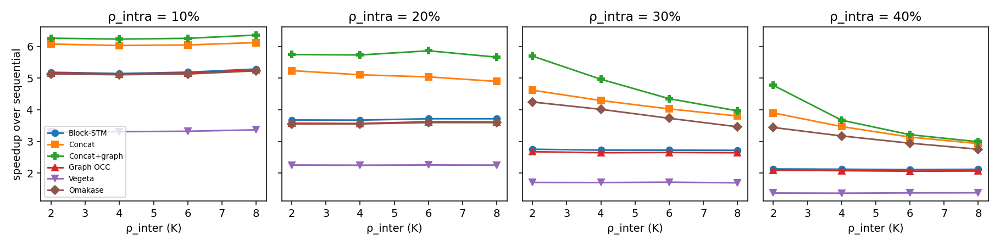

# Rebuttal experiments — generated tables

Machine: c4.8xlarge (18 cores / 36 threads, 58 GiB), t = 8 workers, τ_CV = 0.5, τ_hot = 1.5, InMemoryStorage.

Rounds in which any engine fell back to sequential execution of an optimistic window are excluded from every table (see the note at the end for the count per file).

## Real Ethereum (15 000 mainnet blocks)

**Absolute throughput and per-block latency** — 135 batches, 13,500 blocks, 2,140,517 txs

| Engine | total s | tx/s (aggregate) | ms/block p50 | p90 | p99 | speedup |
|---|---:|---:|---:|---:|---:|---:|
| Sequential | 123.6 | 17,322 | 8.91 | 12.56 | 15.00 | 1.00× |
| Block-STM | 65.2 | 32,823 | 4.58 | 7.12 | 9.76 | 1.89× |
| Block-STM, concatenated | 51.5 | 41,523 | 3.67 | 5.40 | 8.45 | 2.40× |
| Graph-aware OCC, concatenated | 57.1 | 37,501 | 4.05 | 5.59 | 8.55 | 2.16× |
| Graph-aware OCC | 74.3 | 28,805 | 5.35 | 7.66 | 10.45 | 1.66× |
| Vegeta (speculate + batch replay + serial tail) | 93.2 | 22,966 | 6.80 | 9.59 | 12.26 | 1.33× |
| Omakase | 50.1 | 42,757 | 3.73 | 4.35 | 5.50 | 2.47× |

**Where the time goes — full pipeline including the preparatory phases**

| Phase | total s | share | ms/block | cost as a fraction of sequential time |
|---|---:|---:|---:|---:|
| Pre-execute (proposer, once per block) | 125.8 | 52% | 9.32 | 1.02× |
| Build conflict graph + intra-block reorder | 27.3 | 11% | 2.02 | 0.22× |
| Integrate (greedy, per committed round) | 39.3 | 16% | 2.91 | 0.32× |
| Execute (Omakase, parallel) | 50.1 | 21% | 3.71 | 0.41× |
| All phases on one node (single proposer, P = 1) | 242.4 | 100% | 17.96 | 1.96× (speedup 0.51×) |
| Validator-side: integrate + execute | 89.3 |  | 6.62 | 0.72× (speedup 1.38×) |
| **Every stage on one node, 1/P of proposer stages, P = 20** | **97.0** |  | **7.18** | **0.78×** (speedup 1.27×) |
| **Every stage on one node, 1/P of proposer stages, P = 50** | **92.4** |  | **6.84** | **0.75×** (speedup 1.34×) |
| **Every stage on one node, 1/P of proposer stages, P = 100** | **90.9** |  | **6.73** | **0.74×** (speedup 1.36×) |
| Sequential execution (reference) | 123.6 |  | 9.15 | 1.00× |

Vegeta's schedule construction (Rule-1 reorder + DAG rebuild) on the same pre-pass: 21.54 s total, 1.595 ms/block.

**Every stage on one node with P proposers** — round size = P (one block per proposer per round); ms/block

| P | blocks | seq. | proposer stages (pre-exec + graph) | integrate | execute | validator + proposer/P | exec only | integ + exec | every stage on one node, 1/P | Block-STM |
|---|---:|---:|---:|---:|---:|---:|---:|---:|---:|---:|
| 20 | 14,320 | 9.44 | 11.69 | 2.52 | 4.30 | 7.41 | 2.19× | 1.38× | **1.27×** | 1.83× |
| 50 | 14,100 | 9.31 | 11.51 | 2.81 | 4.01 | 7.04 | 2.32× | 1.37× | **1.32×** | 1.86× |
| 100 | 13,500 | 9.15 | 11.34 | 2.91 | 3.71 | 6.73 | 2.47× | 1.38× | **1.36×** | 1.89× |

Integration cost per block grows with the round (more candidate merges) while execution improves (more inter-block parallelism); the proposer stages are paid once per block by its proposer, so a validator pays 1/P of them. Round size 100 is the main campaign; the other sizes are the full-dataset round-size runs (`run_roundsize_full.sh`).

**Metadata shipped in a proposal**

| Payload | MB total | KB/block | vs calldata |
|---|---:|---:|---:|
| Transaction calldata (what a block already carries) | 1544.5 | 114.4 | 100% |
| Omakase per-block conflict graph (access-set hashes + WAW edges) | 249.5 | 18.5 | 16.2% |
| Vegeta schedule (same encoding) | 212.1 | 15.7 | 13.7% |

**Worst case across rounds (execution phase, in-memory)**

| Engine | mean speedup | worst round | p10 | rounds slower than sequential | p90/p50 per-block time |
|---|---:|---:|---:|---:|---:|
| Block-STM | 1.95× | 1.36× | 1.63× | 0 | 1.56 |
| Block-STM, concatenated | 2.46× | 1.51× | 1.93× | 0 | 1.47 |
| Omakase | 2.46× | 1.86× | 2.09× | 0 | 1.17 |

**Speedup by contention level** (rounds split by Block-STM's re-execution rate)

| rounds | Block-STM re-exec/tx | Block-STM | Concat | Omakase |
|---|---:|---:|---:|---:|
| low contention (bottom 20% Block-STM re-exec/tx) | 0.41 | 2.03× | 2.66× | 2.43× |
| high contention (top 20%) | 0.70 | 1.79× | 2.19× | 2.29× |

**Concatenated round: whole-window sequential fallback** — 0 of 135 rounds (concat re-executions = 0 in the diagnostics run; confirmed with `PEVM_TRACE_FALLBACK=1`: a transaction reads an account self-destructed earlier in the same optimistic window, pevm abandons the window and re-executes all of it sequentially). Per-block Block-STM and Omakase's <=10-block groups never fell back on these rounds because the self-destruct and the read land in different windows.

| chunk | round | txs | seq ms/block | Block-STM | Block-STM, concatenated | Graph OCC, concatenated | Graph-aware OCC | Omakase |
|---|---:|---:|---:|---:|---:|---:|---:|---:|

**Per-round statistics with and without the fallback rounds** (execution phase, speedup over sequential)

| rounds | engine | mean | worst | p10 | rounds < 1× | p90/p50 |
|---|---:|---:|---:|---:|---:|---:|
| all rounds | Block-STM | 1.95× | 1.36× | 1.63× | 0 | 1.56 |
| all rounds | Block-STM, concatenated | 2.46× | 1.51× | 1.93× | 0 | 1.47 |
| all rounds | Graph OCC, concatenated | 2.18× | 1.43× | 1.92× | 0 | 1.38 |
| all rounds | Graph-aware OCC | 1.68× | 1.27× | 1.47× | 0 | 1.43 |
| all rounds | Omakase | 2.46× | 1.86× | 2.09× | 0 | 1.17 |
| excluding fallback rounds | Block-STM | 1.95× | 1.36× | 1.63× | 0 | 1.56 |
| excluding fallback rounds | Block-STM, concatenated | 2.46× | 1.51× | 1.93× | 0 | 1.47 |
| excluding fallback rounds | Graph OCC, concatenated | 2.18× | 1.43× | 1.92× | 0 | 1.38 |
| excluding fallback rounds | Graph-aware OCC | 1.68× | 1.27× | 1.47× | 0 | 1.43 |
| excluding fallback rounds | Omakase | 2.46× | 1.86× | 2.09× | 0 | 1.17 |

**Worst genuine (non-fallback) rounds for the concatenated round**, with every engine's speedup and re-executions per tx

| chunk | round | txs | seq ms/block | Block-STM | Block-STM, concatenated | Graph OCC, concatenated | Graph-aware OCC | Omakase | re-exec/tx concat | Block-STM | Omakase |
|---|---:|---:|---:|---:|---:|---:|---:|---:|---:|---:|---:|
| real_18581726.csv | 11 | 14,306 | 14.41 | 1.36× | 1.51× | 1.43× | 1.27× | 3.11× | 0.90 | 0.54 | 0.33 |
| real_18581726.csv | 21 | 14,683 | 15.00 | 1.37× | 1.59× | 1.63× | 1.28× | 2.70× | 1.22 | 0.72 | 0.36 |
| real_18581726.csv | 43 | 15,510 | 10.83 | 1.54× | 1.69× | 1.97× | 1.40× | 2.90× | 1.15 | 0.55 | 0.39 |
| real_18581726.csv | 45 | 15,203 | 9.52 | 1.61× | 1.73× | 1.62× | 1.44× | 2.46× | 1.06 | 0.64 | 0.41 |
| real_18581726.csv | 3 | 13,339 | 9.14 | 1.51× | 1.78× | 2.12× | 1.34× | 2.60× | 1.18 | 0.67 | 0.44 |
| real_18581726.csv | 26 | 14,274 | 11.49 | 1.62× | 1.80× | 1.78× | 1.45× | 2.85× | 0.94 | 0.55 | 0.32 |
| real_18581726.csv | 18 | 15,544 | 11.88 | 1.51× | 1.81× | 1.82× | 1.38× | 3.07× | 0.96 | 0.57 | 0.37 |
| real_18581726.csv | 15 | 15,072 | 11.13 | 1.53× | 1.81× | 1.86× | 1.40× | 1.88× | 0.91 | 0.54 | 0.38 |
| real_18581726.csv | 41 | 16,515 | 8.25 | 1.71× | 1.85× | 2.08× | 1.47× | 1.99× | 0.89 | 0.48 | 0.32 |
| real_18581726.csv | 19 | 15,573 | 9.87 | 1.62× | 1.86× | 1.71× | 1.45× | 2.20× | 1.13 | 0.68 | 0.40 |

**Aborts and re-executions** — 2,140,517 txs (diagnostics build)

| Engine | re-executions / tx | validation aborts / tx | cascade aborts / tx | re-exec writing a new location / tx | cascade share of aborts |
|---|---:|---:|---:|---:|---:|
| Block-STM | 0.545 | 0.183 | 0.1351 | 0.0076 | 74% |
| Block-STM, concatenated | 0.877 | 0.208 | 0.1929 | 0.0081 | 93% |
| Graph OCC, concatenated | 0.545 | 0.294 | 0.2236 | 0.0000 | 76% |
| Graph-aware OCC | 0.268 | 0.123 | 0.0798 | 0.0000 | 65% |
| Vegeta | 0.009 | 0.000 | 0.0000 | 0.0000 | 0% |
| Omakase | 0.309 | 0.151 | 0.1012 | 0.0006 | 67% |

*cascade abort* = validation failure caused by the *re-execution* of a lower-indexed transaction (the invalidating write carries incarnation > 0, is an ESTIMATE left by an aborted incarnation, or is a version the reader saw that a later incarnation no longer writes); an abort caused by a lower-indexed writer's first execution is an ordinary optimistic abort. *re-exec writing a new location* = re-executions whose write set gained a location the previous incarnation had not written (post-blocking first executions excluded).

 

## Synthetic V2 (paper §7.2.2)

**Absolute throughput and per-block latency** — 150 batches, 15,000 blocks, 2,387,073 txs

| Engine | total s | tx/s (aggregate) | ms/block p50 | p90 | p99 | speedup |
|---|---:|---:|---:|---:|---:|---:|
| Sequential | 197.3 | 12,097 | 12.50 | 16.21 | 22.77 | 1.00× |
| Block-STM | 97.9 | 24,381 | 6.06 | 8.08 | 17.03 | 2.02× |
| Block-STM, concatenated | 69.8 | 34,186 | 4.41 | 5.41 | 13.17 | 2.83× |
| Graph-aware OCC, concatenated | 66.0 | 36,181 | 4.18 | 5.09 | 12.97 | 2.99× |
| Graph-aware OCC | 94.9 | 25,156 | 5.86 | 7.98 | 16.80 | 2.08× |
| Vegeta (speculate + batch replay + serial tail) | 144.2 | 16,558 | 9.13 | 11.63 | 20.04 | 1.37× |
| Omakase | 86.4 | 27,627 | 5.35 | 6.88 | 15.19 | 2.28× |

**Where the time goes — full pipeline including the preparatory phases**

| Phase | total s | share | ms/block | cost as a fraction of sequential time |
|---|---:|---:|---:|---:|
| Pre-execute (proposer, once per block) | 200.7 | 61% | 13.38 | 1.02× |
| Build conflict graph + intra-block reorder | 23.5 | 7% | 1.57 | 0.12× |
| Integrate (greedy, per committed round) | 17.8 | 5% | 1.18 | 0.09× |
| Execute (Omakase, parallel) | 86.4 | 26% | 5.76 | 0.44× |
| All phases on one node (single proposer, P = 1) | 328.4 | 100% | 21.89 | 1.66× (speedup 0.60×) |
| Validator-side: integrate + execute | 104.2 |  | 6.94 | 0.53× (speedup 1.89×) |
| **Every stage on one node, 1/P of proposer stages, P = 20** | **115.4** |  | **7.69** | **0.58×** (speedup 1.71×) |
| **Every stage on one node, 1/P of proposer stages, P = 50** | **108.6** |  | **7.24** | **0.55×** (speedup 1.82×) |
| **Every stage on one node, 1/P of proposer stages, P = 100** | **106.4** |  | **7.09** | **0.54×** (speedup 1.85×) |
| Sequential execution (reference) | 197.3 |  | 13.16 | 1.00× |

Vegeta's schedule construction (Rule-1 reorder + DAG rebuild) on the same pre-pass: 31.88 s total, 2.125 ms/block.

**Every stage on one node with P proposers** — round size = P (one block per proposer per round); ms/block

| P | blocks | seq. | proposer stages (pre-exec + graph) | integrate | execute | validator + proposer/P | exec only | integ + exec | every stage on one node, 1/P | Block-STM |
|---|---:|---:|---:|---:|---:|---:|---:|---:|---:|---:|
| 20 | 15,000 | 13.18 | 14.81 | 1.04 | 5.82 | 7.60 | 2.26× | 1.92× | **1.73×** | 2.02× |
| 50 | 15,000 | 13.15 | 14.83 | 1.16 | 5.77 | 7.23 | 2.28× | 1.90× | **1.82×** | 2.01× |
| 100 | 15,000 | 13.16 | 14.95 | 1.18 | 5.76 | 7.09 | 2.28× | 1.89× | **1.85×** | 2.02× |

Integration cost per block grows with the round (more candidate merges) while execution improves (more inter-block parallelism); the proposer stages are paid once per block by its proposer, so a validator pays 1/P of them. Round size 100 is the main campaign; the other sizes are the full-dataset round-size runs (`run_roundsize_full.sh`).

**Metadata shipped in a proposal**

| Payload | MB total | KB/block | vs calldata |
|---|---:|---:|---:|
| Transaction calldata (what a block already carries) | 1587.0 | 105.8 | 100% |
| Omakase per-block conflict graph (access-set hashes + WAW edges) | 230.5 | 15.4 | 14.5% |
| Vegeta schedule (same encoding) | 231.6 | 15.4 | 14.6% |

**Worst case across rounds (execution phase, in-memory)**

| Engine | mean speedup | worst round | p10 | rounds slower than sequential | p90/p50 per-block time |
|---|---:|---:|---:|---:|---:|
| Block-STM | 2.10× | 1.29× | 1.74× | 0 | 1.33 |
| Block-STM, concatenated | 2.95× | 1.66× | 2.33× | 0 | 1.23 |
| Omakase | 2.36× | 1.44× | 1.95× | 0 | 1.29 |

**Speedup by contention level** (rounds split by Block-STM's re-execution rate)

| rounds | Block-STM re-exec/tx | Block-STM | Concat | Omakase |
|---|---:|---:|---:|---:|
| low contention (bottom 20% Block-STM re-exec/tx) | 0.53 | 2.25× | 3.25× | 2.55× |
| high contention (top 20%) | 0.93 | 1.73× | 2.28× | 1.94× |

**Aborts and re-executions** — 2,387,073 txs (diagnostics build)

| Engine | re-executions / tx | validation aborts / tx | cascade aborts / tx | re-exec writing a new location / tx | cascade share of aborts |
|---|---:|---:|---:|---:|---:|
| Block-STM | 0.726 | 0.215 | 0.1550 | 0.0000 | 72% |
| Block-STM, concatenated | 1.164 | 0.220 | 0.1920 | 0.0000 | 87% |
| Graph OCC, concatenated | 0.000 | 0.000 | 0.0000 | 0.0000 | 0% |
| Graph-aware OCC | 0.000 | 0.000 | 0.0000 | 0.0000 | 0% |
| Vegeta | 0.000 | 0.000 | 0.0000 | 0.0000 | 0% |
| Omakase | 0.000 | 0.000 | 0.0000 | 0.0000 | 0% |

*cascade abort* = validation failure caused by the *re-execution* of a lower-indexed transaction (the invalidating write carries incarnation > 0, is an ESTIMATE left by an aborted incarnation, or is a version the reader saw that a later incarnation no longer writes); an abort caused by a lower-indexed writer's first execution is an ordinary optimistic abort. *re-exec writing a new location* = re-executions whose write set gained a location the previous incarnation had not written (post-blocking first executions excluded).

 

## Artificial workload (tunable conflict)

**Artificial workload — speedup over sequential (t=8, H=5)**

| ρ_inter K | ρ_intra M | Block-STM | Concat | Concat+graph | Graph OCC | Vegeta | Omakase |
|---|---:|---:|---:|---:|---:|---:|---:|
| 2 | 10% | 5.19 | 6.08 | 6.27 | 5.17 | 3.30 | 5.13 |
| 4 | 10% | 5.15 | 6.04 | 6.24 | 5.14 | 3.31 | 5.11 |
| 6 | 10% | 5.19 | 6.05 | 6.26 | 5.16 | 3.32 | 5.13 |
| 8 | 10% | 5.29 | 6.13 | 6.37 | 5.26 | 3.37 | 5.23 |
| 2 | 20% | 3.68 | 5.24 | 5.75 | 3.57 | 2.25 | 3.55 |
| 4 | 20% | 3.67 | 5.11 | 5.74 | 3.57 | 2.25 | 3.55 |
| 6 | 20% | 3.72 | 5.04 | 5.87 | 3.62 | 2.25 | 3.60 |
| 8 | 20% | 3.72 | 4.90 | 5.67 | 3.61 | 2.25 | 3.59 |
| 2 | 30% | 2.75 | 4.62 | 5.70 | 2.67 | 1.70 | 4.25 |
| 4 | 30% | 2.72 | 4.29 | 4.97 | 2.64 | 1.70 | 4.02 |
| 6 | 30% | 2.72 | 4.03 | 4.35 | 2.65 | 1.71 | 3.73 |
| 8 | 30% | 2.72 | 3.81 | 3.97 | 2.64 | 1.69 | 3.46 |
| 2 | 40% | 2.13 | 3.90 | 4.78 | 2.09 | 1.37 | 3.44 |
| 4 | 40% | 2.12 | 3.47 | 3.67 | 2.07 | 1.36 | 3.17 |
| 6 | 40% | 2.11 | 3.14 | 3.21 | 2.06 | 1.37 | 2.94 |
| 8 | 40% | 2.12 | 2.93 | 2.99 | 2.06 | 1.37 | 2.75 |

**Artificial workload — re-executions per transaction**

| K | M | Block-STM | Concat | Concat+graph | Graph OCC | Vegeta | Omakase |
|---|---:|---:|---:|---:|---:|---:|---:|
| 2 | 10% | 0.100 | 0.101 | 0.000 | 0.000 | 0.000 | 0.000 |
| 4 | 10% | 0.100 | 0.105 | 0.000 | 0.000 | 0.000 | 0.000 |
| 6 | 10% | 0.100 | 0.108 | 0.000 | 0.000 | 0.000 | 0.000 |
| 8 | 10% | 0.100 | 0.109 | 0.000 | 0.000 | 0.000 | 0.000 |
| 2 | 20% | 0.452 | 0.469 | 0.000 | 0.000 | 0.000 | 0.000 |
| 4 | 20% | 0.452 | 0.589 | 0.000 | 0.000 | 0.000 | 0.000 |
| 6 | 20% | 0.452 | 0.700 | 0.000 | 0.000 | 0.000 | 0.000 |
| 8 | 20% | 0.453 | 0.785 | 0.000 | 0.000 | 0.000 | 0.000 |
| 2 | 30% | 0.942 | 1.043 | 0.000 | 0.000 | 0.000 | 0.000 |
| 4 | 30% | 0.942 | 1.287 | 0.000 | 0.000 | 0.000 | 0.000 |
| 6 | 30% | 0.941 | 1.515 | 0.000 | 0.000 | 0.000 | 0.000 |
| 8 | 30% | 0.945 | 1.673 | 0.000 | 0.000 | 0.000 | 0.000 |
| 2 | 40% | 1.522 | 1.807 | 0.000 | 0.000 | 0.000 | 0.000 |
| 4 | 40% | 1.526 | 2.188 | 0.000 | 0.000 | 0.000 | 0.000 |
| 6 | 40% | 1.529 | 2.574 | 0.000 | 0.000 | 0.000 | 0.000 |
| 8 | 40% | 1.530 | 2.831 | 0.000 | 0.000 | 0.000 | 0.000 |

## Thread-count sweep — artificial

| worker threads | Block-STM | Concat | Concat+graph | Graph OCC | Vegeta | Omakase | groups/batch | re-exec/tx: Concat | Omakase |
|---|---:|---:|---:|---:|---:|---:|---:|---:|---:|
| 4 | 2.07 | 2.40 | 3.21 | 2.10 | 1.26 | 2.09 | 50.0 | 1.574 | 0.000 |
| 8 | 2.11 | 3.47 | 3.71 | 2.07 | 1.36 | 3.16 | 25.1 | 2.222 | 0.000 |
| 16 | 1.30 | 2.55 | 3.24 | 1.90 | 1.34 | 3.05 | 14.3 | 3.404 | 0.000 |
| 24 | 1.22 | 2.49 | 3.20 | 1.76 | 1.28 | 2.89 | 14.5 | 3.460 | 0.000 |
| 32 | 1.22 | 2.35 | 3.14 | 1.57 | 1.20 | 2.69 | 14.5 | 3.451 | 0.000 |

## Thread-count sweep — real

| worker threads | Block-STM | Concat | Concat+graph | Graph OCC | Vegeta | Omakase | groups/batch | re-exec/tx: Concat | Omakase |
|---|---:|---:|---:|---:|---:|---:|---:|---:|---:|
| 4 | 1.80 | 2.28 | 2.08 | 1.70 | 1.26 | 2.29 | 43.5 | 0.339 | 0.228 |
| 8 | 1.98 | 2.59 | 2.25 | 1.75 | 1.31 | 2.56 | 21.2 | 0.904 | 0.315 |
| 16 | 1.32 | 1.92 | 1.99 | 1.62 | 1.25 | 2.21 | 46.2 | 1.316 | 0.293 |
| 24 | 1.24 | 1.89 | 2.06 | 1.57 | 1.21 | 2.06 | 66.9 | 1.514 | 0.253 |
| 32 | 1.22 | 1.69 | 2.05 | 1.51 | 1.18 | 1.93 | 80.0 | 1.602 | 0.226 |

## Thread-count sweep — v2

| worker threads | Block-STM | Concat | Concat+graph | Graph OCC | Vegeta | Omakase | groups/batch | re-exec/tx: Concat | Omakase |
|---|---:|---:|---:|---:|---:|---:|---:|---:|---:|
| 4 | 1.93 | 2.72 | 3.02 | 2.15 | 1.41 | 2.21 | 93.2 | 0.296 | 0.000 |
| 8 | 2.16 | 3.51 | 3.81 | 2.25 | 1.49 | 2.56 | 66.7 | 0.865 | 0.000 |
| 16 | 1.34 | 2.44 | 3.22 | 2.03 | 1.44 | 2.21 | 84.9 | 1.277 | 0.000 |
| 24 | 1.24 | 2.37 | 3.28 | 1.93 | 1.40 | 1.99 | 95.8 | 1.394 | 0.000 |
| 32 | 1.24 | 2.12 | 3.28 | 1.83 | 1.36 | 1.84 | 98.2 | 1.417 | 0.000 |

## Round-size sweep — artificial

| blocks per round | Block-STM | Concat | Concat+graph | Graph OCC | Vegeta | Omakase | groups/batch | re-exec/tx: Concat | Omakase |
|---|---:|---:|---:|---:|---:|---:|---:|---:|---:|
| 5 | 2.12 | 2.55 | 2.57 | 2.08 | 1.37 | 2.48 | 3.8 | 2.518 | 0.000 |
| 10 | 2.13 | 3.20 | 3.34 | 2.09 | 1.37 | 2.96 | 5.9 | 2.262 | 0.000 |
| 20 | 2.11 | 3.18 | 3.34 | 2.07 | 1.38 | 2.94 | 11.5 | 2.309 | 0.000 |
| 50 | 2.15 | 3.53 | 3.75 | 2.10 | 1.38 | 3.21 | 25.1 | 2.239 | 0.000 |
| 100 | 2.13 | 3.46 | 3.66 | 2.07 | 1.37 | 3.21 | 48.8 | 2.259 | 0.000 |

## Round-size sweep — real

| blocks per round | Block-STM | Concat | Concat+graph | Graph OCC | Vegeta | Omakase | groups/batch | re-exec/tx: Concat | Omakase |
|---|---:|---:|---:|---:|---:|---:|---:|---:|---:|
| 5 | 1.89 | 2.37 | 2.08 | 1.71 | 1.28 | 2.03 | 2.6 | 0.913 | 0.339 |
| 10 | 1.90 | 2.50 | 2.18 | 1.71 | 1.28 | 2.18 | 4.1 | 0.952 | 0.339 |
| 20 | 1.92 | 2.54 | 2.19 | 1.71 | 1.28 | 2.30 | 6.6 | 0.951 | 0.336 |
| 50 | 1.95 | 2.54 | 2.22 | 1.73 | 1.29 | 2.45 | 12.2 | 0.933 | 0.330 |
| 100 | 1.97 | 2.58 | 2.23 | 1.74 | 1.29 | 2.54 | 21.2 | 0.905 | 0.316 |

## Merge-cap sweep (Omakase only varies) — artificial

| merge cap (blocks/group) | Block-STM | Concat | Concat+graph | Graph OCC | Vegeta | Omakase | groups/batch | re-exec/tx: Concat | Omakase |
|---|---:|---:|---:|---:|---:|---:|---:|---:|---:|
| 10 | 2.12 | 3.45 | 3.69 | 2.07 | 1.36 | 3.16 | 25.1 | 2.253 | 0.000 |
| 25 | 2.12 | 3.47 | 3.70 | 2.07 | 1.36 | 3.15 | 25.1 | 2.234 | 0.000 |
| 50 | 2.11 | 3.47 | 3.70 | 2.06 | 1.37 | 3.16 | 25.1 | 2.240 | 0.000 |
| 1000 | 2.12 | 3.48 | 3.71 | 2.08 | 1.36 | 3.17 | 25.1 | 2.240 | 0.000 |

## Merge-cap sweep (Omakase only varies) — real

| merge cap (blocks/group) | Block-STM | Concat | Concat+graph | Graph OCC | Vegeta | Omakase | groups/batch | re-exec/tx: Concat | Omakase |
|---|---:|---:|---:|---:|---:|---:|---:|---:|---:|
| 10 | 1.97 | 2.59 | 2.25 | 1.74 | 1.30 | 2.55 | 21.2 | 0.905 | 0.317 |
| 25 | 1.96 | 2.57 | 2.23 | 1.73 | 1.29 | 2.53 | 20.9 | 0.909 | 0.317 |
| 50 | 1.97 | 2.58 | 2.25 | 1.74 | 1.30 | 2.56 | 20.9 | 0.909 | 0.316 |
| 1000 | 1.97 | 2.58 | 2.24 | 1.74 | 1.30 | 2.54 | 20.9 | 0.906 | 0.317 |

## Aggressive integration (merge unless hot-key conflict) — artificial

| merge cap, tau_cv=0.01 | Block-STM | Concat | Concat+graph | Graph OCC | Vegeta | Omakase | groups/batch | re-exec/tx: Concat | Omakase |
|---|---:|---:|---:|---:|---:|---:|---:|---:|---:|
| 10 | 2.12 | 3.48 | 3.70 | 2.08 | 1.36 | 3.40 | 13.3 | 2.245 | 0.000 |
| 50 | 2.12 | 3.47 | 3.68 | 2.07 | 1.36 | 3.46 | 4.8 | 2.246 | 0.000 |
| 1000 | 2.12 | 3.46 | 3.71 | 2.08 | 1.37 | 3.48 | 4.8 | 2.240 | 0.000 |

## Aggressive integration (merge unless hot-key conflict) — real

| merge cap, tau_cv=0.01 | Block-STM | Concat | Concat+graph | Graph OCC | Vegeta | Omakase | groups/batch | re-exec/tx: Concat | Omakase |
|---|---:|---:|---:|---:|---:|---:|---:|---:|---:|
| 10 | 1.96 | 2.58 | 2.25 | 1.73 | 1.29 | 2.63 | 10.6 | 0.891 | 0.334 |
| 50 | 1.96 | 2.63 | 2.33 | 1.75 | 1.28 | 2.75 | 7.1 | 0.858 | 0.333 |
| 1000 | 1.96 | 2.63 | 2.32 | 1.75 | 1.28 | 2.73 | 7.4 | 0.855 | 0.328 |

## Per-transaction cost sweep — artificial

| simulated work per tx (TARGET) | Block-STM | Concat | Concat+graph | Graph OCC | Vegeta | Omakase | groups/batch | re-exec/tx: Concat | Omakase |
|---|---:|---:|---:|---:|---:|---:|---:|---:|---:|
| 100 | 2.13 | 3.51 | 3.71 | 2.08 | 1.37 | 3.19 | 25.0 | 2.252 | 0.000 |
| 500 | 2.36 | 4.13 | 4.27 | 2.38 | 1.86 | 3.81 | 25.2 | 3.415 | 0.000 |
| 2000 | 2.50 | 4.39 | 4.49 | 2.51 | 1.99 | 4.01 | 25.3 | 4.131 | 0.000 |

## Hot-key threshold sweep (τ_CV = 0.5) — real

Only Omakase depends on this parameter (sequential + Omakase timed, `ENGINES=omakase`).

| hot-key threshold τ_hot | rounds | Omakase speedup (agg.) | mean/round | median | min | max | groups/round | integrate ms/block | re-exec/tx |
|---|---:|---:|---:|---:|---:|---:|---:|---:|---:|
| 0.5 | 148 | **2.27×** | 2.25 | 2.10 | 1.69 | 5.60 | 67.6 | 2.04 | 0.255 |
| 1 | 139 | **2.46×** | 2.45 | 2.29 | 1.87 | 4.32 | 28.2 | 2.86 | 0.305 |
| 1.5 (paper) | 143 | **2.46×** | 2.46 | 2.30 | 1.84 | 4.45 | 23.8 | 2.92 | 0.308 |
| 3 | 141 | **2.48×** | 2.47 | 2.31 | 1.84 | 4.39 | 22.7 | 2.95 | 0.309 |
| 5 | 141 | **2.47×** | 2.46 | 2.32 | 1.86 | 4.40 | 22.6 | 2.95 | 0.309 |

## τ_CV sweep (τ_hot = 1.5) — real

Only Omakase depends on this parameter (sequential + Omakase timed, `ENGINES=omakase`).

| CV threshold τ_CV | rounds | Omakase speedup (agg.) | mean/round | median | min | max | groups/round | integrate ms/block | re-exec/tx |
|---|---:|---:|---:|---:|---:|---:|---:|---:|---:|
| 0.1 | 138 | **2.52×** | 2.51 | 2.34 | 1.86 | 4.44 | 16.1 | 3.62 | 0.316 |
| 0.3 | 139 | **2.51×** | 2.49 | 2.34 | 1.88 | 4.41 | 19.5 | 3.28 | 0.312 |
| 0.5 (paper) | 143 | **2.46×** | 2.46 | 2.30 | 1.88 | 4.47 | 23.8 | 2.92 | 0.308 |
| 1 | 146 | **2.35×** | 2.33 | 2.17 | 1.80 | 4.12 | 42.6 | 2.32 | 0.283 |
| 2 | 150 | **2.14×** | 2.12 | 1.97 | 1.61 | 5.38 | 97.3 | 1.45 | 0.217 |

## Pipelined integration — real

| blocks/round | rounds | txs | seq s | Block-STM s | Omakase serial s | integration s | Omakase pipelined s | integration hidden |
|---|---:|---:|---:|---:|---:|---:|---:|---:|
| 100 | 10 | 170746 | 9.81 | 4.98 (1.97×) | 8.34 (1.18×) | 3.63 | 5.16 (1.90×) | 87% |
| 20 | 20 | 70070 | 4.00 | 2.05 (1.95×) | 3.60 (1.11×) | 1.38 | 2.32 (1.73×) | 93% |

## Emulated state-access latency — real Ethereum (20 Cancun batches, t=8)

| read latency µs | seq ms/block | Block-STM × | Concat × | Omakase exec × | Omakase exec+integrate × | integrate ms/block | integrate share of validator time | exec saved vs Block-STM ms/block | re-exec/tx Block-STM | Omakase |
|---|---:|---:|---:|---:|---:|---:|---:|---:|---:|---:|
| 0 | 10.8 | 1.96 | 2.58 | 2.67 | 1.46 | 3.36 | 45% | 1.46 | 0.62 | 0.32 |
| 1 | 13.8 | 2.13 | 2.83 | 2.78 | 1.65 | 3.38 | 41% | 1.51 | 0.61 | 0.31 |
| 2 | 15.3 | 2.15 | 2.87 | 2.76 | 1.71 | 3.40 | 38% | 1.57 | 0.61 | 0.31 |
| 5 | 19.6 | 2.24 | 2.97 | 2.75 | 1.86 | 3.43 | 32% | 1.61 | 0.59 | 0.30 |
| 10 | 27.2 | 2.34 | 3.02 | 2.76 | 2.06 | 3.38 | 26% | 1.75 | 0.58 | 0.30 |
| 20 | 42.1 | 2.42 | 3.07 | 2.78 | 2.27 | 3.41 | 18% | 2.26 | 0.58 | 0.31 |
| 50 | 86.7 | 2.44 | 3.07 | 2.76 | 2.49 | 3.40 | 10% | 4.19 | 0.57 | 0.32 |

Every account/slot read pays the latency in every engine; graph construction and integration never touch state and stay constant.

**Read latency × worker count** (real Ethereum, 20 batches; speedup over sequential at the same latency)

| read latency µs | workers | Block-STM | Concat | Omakase exec | Omakase exec+integ |
|---|---:|---:|---:|---:|---:|
| 20 | 8 | 2.42 | 3.07 | 2.78 | 2.27 |
| 20 | 16 | 2.14 | 2.90 | 2.61 | 2.18 |
| 20 | 32 | 2.04 | 2.63 | 2.43 | 2.12 |
| 50 | 8 | 2.44 | 3.07 | 2.76 | 2.49 |
| 50 | 16 | 2.36 | 3.09 | 2.71 | 2.46 |
| 50 | 32 | 2.23 | 2.88 | 2.50 | 2.33 |

## Live 4-validator Mysticeti deployment — minround1000 (ERC20 8x4x8, steady state, per validator)

| execution mode | load step | committed tx/s | executor busy | implied executor capacity tx/s | blocks/round | rounds |
|---|---:|---:|---:|---:|---:|---:|
| sequential | 0 | 39,721 | 41% | 97,118 | 9.6 | 2,617 |
| parallel | 0 | 39,997 | 45% | 88,196 | 9.8 | 2,606 |
| concatenated | 0 | 40,005 | 35% | 113,088 | 9.9 | 2,666 |
| integrated | 0 | 39,951 | 80% | 49,815 | 4.1 | 1,174 |

The generator caps committed throughput at ~40k tx/s per validator in every mode, so the executor is never the bottleneck here; *executor busy* is the share of wall-clock the executor spends on its round (all stages, pre-execution and integration included for Omakase), and *implied capacity* = tx/s ÷ busy. Load step 0/1 = successive PEVM_LOAD settings.

## Rounds excluded because an engine fell back to sequential execution

| file | rounds excluded |
|---|---:|
| aggressive_real_c10.csv | 2 |
| aggressive_real_c1000.csv | 9 |
| aggressive_real_c50.csv | 9 |
| hot_real_h0.5_18581726.csv | 1 |
| hot_real_h0.5_19557289.csv | 1 |
| hot_real_h1.0_16774645.csv | 4 |
| hot_real_h1.0_18581726.csv | 5 |
| hot_real_h1.0_19557289.csv | 2 |
| hot_real_h1.5_16774645.csv | 1 |
| hot_real_h1.5_18581726.csv | 5 |
| hot_real_h1.5_19557289.csv | 1 |
| hot_real_h3.0_16774645.csv | 3 |
| hot_real_h3.0_18581726.csv | 5 |
| hot_real_h3.0_19557289.csv | 1 |
| hot_real_h5.0_16774645.csv | 3 |
| hot_real_h5.0_18581726.csv | 5 |
| hot_real_h5.0_19557289.csv | 1 |
| mergecap_real_c10.csv | 1 |
| mergecap_real_c1000.csv | 1 |
| mergecap_real_c25.csv | 1 |
| mergecap_real_c50.csv | 1 |
| real_16774645.csv | 4 |
| real_16774645_diag.csv | 4 |
| real_18581726.csv | 7 |
| real_18581726_diag.csv | 7 |
| real_19557289.csv | 4 |
| real_19557289_diag.csv | 4 |
| roundsize_full_real_b20_16774645.csv | 15 |
| roundsize_full_real_b20_18581726.csv | 9 |
| roundsize_full_real_b20_19557289.csv | 10 |
| roundsize_full_real_b50_16774645.csv | 7 |
| roundsize_full_real_b50_18581726.csv | 3 |
| roundsize_full_real_b50_19557289.csv | 8 |
| roundsize_real_b10.csv | 4 |
| roundsize_real_b100.csv | 1 |
| roundsize_real_b20.csv | 5 |
| roundsize_real_b5.csv | 1 |
| roundsize_real_b50.csv | 3 |
| statelat_real_d0.csv | 1 |
| statelat_real_d1000.csv | 1 |
| statelat_real_d10000.csv | 1 |
| statelat_real_d2000.csv | 1 |
| statelat_real_d20000.csv | 1 |
| statelat_real_d20000_t16.csv | 2 |
| statelat_real_d20000_t32.csv | 1 |
| statelat_real_d5000.csv | 1 |
| statelat_real_d50000.csv | 1 |
| statelat_real_d50000_t16.csv | 3 |
| statelat_real_d50000_t32.csv | 1 |
| tau_real_t0.1_16774645.csv | 4 |
| tau_real_t0.1_18581726.csv | 5 |
| tau_real_t0.1_19557289.csv | 3 |
| tau_real_t0.3_16774645.csv | 4 |
| tau_real_t0.3_18581726.csv | 5 |
| tau_real_t0.3_19557289.csv | 2 |
| tau_real_t0.5_16774645.csv | 1 |
| tau_real_t0.5_18581726.csv | 5 |
| tau_real_t0.5_19557289.csv | 1 |
| tau_real_t1.0_16774645.csv | 1 |
| tau_real_t1.0_19557289.csv | 3 |
| threads_real_t16.csv | 2 |
| threads_real_t24.csv | 1 |
| threads_real_t32.csv | 1 |
| threads_real_t4.csv | 1 |
| threads_real_t8.csv | 1 |
